# Blue-Green Deployment Strategy on AWS (Capstone 3)

Zero-downtime web-tier deployments for a Nairobi-based telecom customer portal, using two identical EC2 environments behind one Application Load Balancer, weighted traffic switching, CloudWatch monitoring, and automated rollback with EventBridge + Lambda.

- **Region:** eu-west-1 (Ireland)
- **ALB:** `http://bg-alb-1190525953.eu-west-1.elb.amazonaws.com` (production :80, Green test :8080)
- **Blue:** v1.0, current/standby | **Green:** v2.0, new release

---

## 1. Architecture

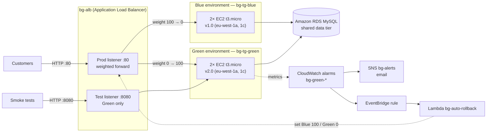

### Design decisions

| Decision | Reason |
|---|---|
| One ALB, two target groups | Traffic moves by changing listener weights. No DNS change, no TTL wait, so no downtime. |
| Weighted prod listener (:80) | Allows gradual shifts (10% → 50% → 100%) and an instant revert. |
| Green-only test listener (:8080) | Green is tested through the real ALB path before any customer reaches it. |
| Shared SG, IAM profile, AMI, subnets | Environment parity by construction. Only the `Env` and `Version` tags differ. |
| AMI resolved once from SSM and reused | Blue and Green are guaranteed to run the identical image. |
| Blue kept running after cutover | Rollback stays a single API call with no rebuild. |

### Data tier (RDS MySQL)

The data tier is **shared, not duplicated**. Blue and Green point at the same RDS instance, so customer data never has to be copied or synchronised during a switch. The consequence is that **schema changes must be backward compatible** (expand → migrate → contract): add new columns/tables first, deploy code that works with both schemas, and only remove old columns after Blue is retired. For cost reasons RDS was not provisioned in this lab. The web tier was built and tested without it.

### Environment parity (evidence: `docs/screenshots/01-parity-table.png`)

| Env | Version | AMI | Type | Security group | IAM profile | AZs |
|---|---|---|---|---|---|---|
| blue | v1.0 | ami-058f31f10d44d9317 | t3.micro | bg-web-sg | bg-web-profile | eu-west-1a, 1c |
| green | v2.0 | ami-058f31f10d44d9317 | t3.micro | bg-web-sg | bg-web-profile | eu-west-1a, 1c |

Exported live configuration is in [`docs/config/`](docs/config/): ALB, listeners (with weights), target groups, security groups, alarms, EventBridge rule.

---

## 2. Repository layout

```
scripts/
  setup-infra.sh   Builds SGs, IAM, target groups, ALB + listeners, SNS, alarms, dashboard, Lambda, EventBridge
  userdata.sh      Instance bootstrap: httpd, versioned page, /health, CloudWatch agent (memory)
  launch.sh        Launches 2 identical instances (one per AZ) for blue or green
  register.sh      Registers an environment's instances in its target group
  smoke-test.sh    7 checks against Green via the :8080 test listener
  switch.sh        Sets listener weights; refuses to send traffic to an unhealthy Green
  gradual.sh       10% → 50% → 100% with alarm checks every 10s; auto-reverts on alarm
  traffic.sh       Sends a request every 0.5s and prints which environment answered
lambda/rollback.py Auto-rollback function (EventBridge → Lambda → ModifyListener)
docs/dashboard.json  CloudWatch dashboard definition
docs/config/       Exported live AWS configuration
docs/screenshots/  Evidence
deploy.log         Timestamped record of every weight change
```

All scripts are bash and run on macOS (bash 3.2) or AWS CloudShell. IDs are stored in `~/bg.env`.

---

## 3. Deployment guide

```bash
# 1. Infrastructure (once)
./scripts/setup-infra.sh you@example.com      # then confirm the SNS email

# 2. Blue (current live version)
./scripts/launch.sh blue v1.0 && ./scripts/register.sh blue

# 3. Green (new version) – receives 0% production traffic
./scripts/launch.sh green v2.0 && ./scripts/register.sh green
```

### Validation before any traffic moves

1. **Health checks** on both target groups: `GET /health` must return `200` within 5s, every 10s; 2 failures = unhealthy, 2 passes = healthy (`03-health-check-config.png`).
2. **Smoke tests** through the test listener:
   ```bash
   ./scripts/smoke-test.sh v2.0
   ```
   | Check | Purpose |
   |---|---|
   | `/health` returns 200 | Health endpoint works |
   | Page shows `Version: v2.0` | Correct artifact deployed |
   | Test listener shows `GREEN` | Test path is isolated |
   | 50/50 requests return 200 | No intermittent failures |
   | Avg latency < 0.5s | Performance acceptable |
   | All Green targets healthy | ALB agrees Green is ready |
   | Production :80 still on Blue | Deployment isolation intact |

   Observed result: **7/7 passed, average latency 0.320s** (`04-smoke-test-green.png`, `docs/smoke-test-green.txt`).
3. **Logs on Green** (via SSM, no SSH):
   ```bash
   aws ssm send-command --document-name AWS-RunShellScript --targets Key=tag:Env,Values=green \
     --parameters '{"commands":["systemctl is-active httpd","tail -3 /var/log/httpd/error_log"]}'
   ```

---

## 4. Traffic switch guide

**Preconditions:** smoke test passed, all Green targets healthy, no `bg-` alarm in ALARM, SNS subscription confirmed.

```bash
# Terminal 2 – live view (zero-downtime evidence)
./scripts/traffic.sh | tee docs/traffic-switch.log

# Terminal 1 – gradual shift with automatic abort
./scripts/gradual.sh
```

| Stage | Command run by `gradual.sh` | Soak | Go / no-go |
|---|---|---|---|
| Canary | `switch.sh 90 10` | 3 min | Any `bg-green-*` alarm → revert to Blue 100 |
| Half | `switch.sh 50 50` | 3 min | Same |
| Full | `switch.sh 0 100` | 3 min | Same |

Manual control at any time: `./scripts/switch.sh <blue> <green>`, e.g. `./scripts/switch.sh 75 25`. `switch.sh` aborts if any Green target is not healthy.

Watch the `bg-deployment` dashboard during the switch: request count per target group, target 5XX, p90 latency, healthy hosts, CPU, memory.

---

## 5. Monitoring

Dashboard: CloudWatch → Dashboards → `bg-deployment` ([`docs/dashboard.json`](docs/dashboard.json)).

| Alarm | Metric (Green TG unless noted) | Threshold | Action |
|---|---|---|---|
| `bg-green-unhealthy` | UnHealthyHostCount (Max) | ≥ 1 for 1×60s | Email + auto-rollback |
| `bg-green-5xx` | HTTPCode_Target_5XX_Count (Sum) | ≥ 5 in 60s | Email + auto-rollback |
| `bg-green-latency` | TargetResponseTime (p90) | > 1s for 2×60s | Email + auto-rollback |
| `bg-alb-5xx` | HTTPCode_ELB_5XX_Count (ALB) | ≥ 5 in 60s | Email only |

Why these thresholds: one unhealthy host is half of Green's capacity, so it triggers immediately; 5 errors/minute filters single stray failures; latency uses two periods so one slow minute does not cause a rollback. Missing data is treated as not breaching so an idle Green does not alarm.

---

## 6. Rollback plan

### Triggers
Any `bg-green-*` alarm entering ALARM, a failed smoke test, an unhealthy Green target, or an operator decision.

### Manual rollback (one command, seconds)
```bash
./scripts/switch.sh 100 0
curl -s http://$ALB_DNS/ | grep Environment    # expect: Environment: BLUE
```
Blue is never modified during a release, so reverting is only a listener update.

### Automatic rollback
`bg-green-*` alarm → EventBridge rule `bg-green-alarm-rollback` → Lambda `bg-auto-rollback` sets Blue 100 / Green 0 and emails `bg-alerts`. The Lambda role may only call `ModifyListener` on the production listener and `Publish` on the topic (least privilege). `gradual.sh` also reverts on its own if it sees an alarm during a soak.

### After a rollback
1. Confirm production shows `Environment: BLUE`.
2. Investigate Green while it is isolated (0% traffic): `aws logs tail /aws/lambda/bg-auto-rollback`, alarm history, and httpd/cloud-init logs via SSM.
3. Fix, redeploy to Green, rerun smoke tests, then `gradual.sh` again.

---

## 7. Report: planned vs observed (28 Oct 2026, UTC)

### Traffic switch (`deploy.log`)

| Step | Planned | Observed |
|---|---|---|
| Smoke tests | 7/7 pass | 7/7 pass, 0.320s avg latency |
| 10% Green | 07:56, soak 3 min | 07:56:22 |
| 50% Green | +3 min | 08:01:33 (5m11s later) |
| 100% Green | +3 min | 08:05:47 (4m14s later) |
| Server-side errors during switch | 0 | **0**: no `HTTPCode_ELB_5XX` datapoints 07:55–08:17; ALB counted 904 requests |
| Client-side errors (`traffic.sh`) | 0 | 112 of 1,009 requests failed client-side (see lessons learned) |

Soaks took longer than 3 minutes because each loop also queries CloudWatch and target health, which adds time per iteration.

### Automatic rollback test
| Time (UTC) | Event |
|---|---|
| 08:14:59 | Lambda invoked directly with a test event → traffic set to Blue 100, email received |
| 08:15:49 | Traffic returned to Green 100 for the drill |

### Failure drill: httpd stopped on both Green instances while Green served 100%

| Time (UTC) | Event | Elapsed |
|---|---|---|
| 08:17:36 | `systemctl stop httpd` sent to Green via SSM | 0s |
| 08:17:38 | First failed request in `traffic.sh` | 2s |
| 08:20:48 | `bg-green-unhealthy` OK → ALARM (datapoint 2.0 for 08:17) | 3m12s |
| 08:20:49 | Lambda: "AUTO-ROLLBACK … Production traffic is now 100% Blue" | 3m13s |
| 08:21:01 | First `Environment: BLUE` response | **3m25s** |

| Item | Planned | Observed |
|---|---|---|
| Rollback without human action | Yes | **Yes** |
| Time to recover | 1–2 min | 3m25s |
| Alarm that triggered it | Unhealthy hosts or 5XX | Unhealthy hosts only |
| Automation time (alarm → Blue) | Seconds | 13s |

Evidence: `11-dashboard-drill.png`, `12-traffic-rollback-drill.png`, `13-sns-alarm-email.png`, `14-sns-rollback-email.png`, `15-lambda-rollback-log.png`, `docs/rollback-drill.log`, `docs/lambda-rollback.log`.

---

## 8. Lessons learned

1. **Alarm latency dominated recovery time.** The automation took 13s, but the alarm needed about 3 minutes to fire because ALB metrics publish per minute and arrive late. Faster options: have a poller check target health directly every 10s (as `switch.sh` already does), or keep a small Blue weight during the first minutes of a release so failures are absorbed.
2. **The 5XX alarms did not detect this failure.** With httpd stopped, Green never returned application errors, so `HTTPCode_Target_5XX` stayed empty. Only the target-health alarm caught it. A rollback trigger needs both an error-rate and a health signal.
3. **Client-side failures are not the same as downtime.** `traffic.sh` logged 112 failures during the switch, but the ALB recorded zero 5XX errors and served 904 requests. The failures came from 2-second client timeouts on the corporate network. Next time, generate test traffic from inside AWS (CloudShell) for a clean measurement.
4. **Default security group egress matters.** A custom SG without outbound rules blocks package installs and ECR pulls. Keep egress open or define it explicitly.
5. **Shell differences break copy-pasted commands.** zsh does not word-split variables (`$COMMON`) and treats `$VAR:a` as a path modifier; macOS ships bash 3.2 without `${var^^}`. The scripts avoid these, and `setup-infra.sh` makes the whole build reproducible instead of pasted.
6. **Save every ID to a file.** Losing shell variables after a timeout cost time in the previous capstone; `~/bg.env` fixed that.

---

## 9. Cleanup and decommission

**Decision:** Blue (v1.0) is kept running as a warm standby after the switch, so rollback stays instant. For the next release the roles swap: v3.0 is deployed into the idle Blue target group, and the same scripts run in reverse.

**Versioning:** every instance is tagged `Version` (v1.0 / v2.0), the page and `/health` report the version, and `deploy.log` records every weight change with a UTC timestamp.

**Full teardown** (after grading):
```bash
source ~/bg.env
aws events remove-targets --rule bg-green-alarm-rollback --ids rollback
aws events delete-rule --name bg-green-alarm-rollback
aws lambda delete-function --function-name bg-auto-rollback
aws cloudwatch delete-alarms --alarm-names bg-green-5xx bg-green-unhealthy bg-green-latency bg-alb-5xx
aws cloudwatch delete-dashboards --dashboard-names bg-deployment
aws elbv2 delete-load-balancer --load-balancer-arn $ALB_ARN
aws ec2 terminate-instances --instance-ids $(aws ec2 describe-instances --filters Name=tag:Env,Values=blue,green Name=instance-state-name,Values=pending,running,stopped --query 'Reservations[].Instances[].InstanceId' --output text)
aws ec2 wait instance-terminated --filters Name=tag:Env,Values=blue,green
aws elbv2 delete-target-group --target-group-arn $TG_BLUE
aws elbv2 delete-target-group --target-group-arn $TG_GREEN
aws ec2 delete-security-group --group-id $WEB_SG
aws ec2 delete-security-group --group-id $ALB_SG
aws sns delete-topic --topic-arn $TOPIC
```

---

## 10. Evidence

| # | Screenshot | Shows |
|---|---|---|
| 01 | 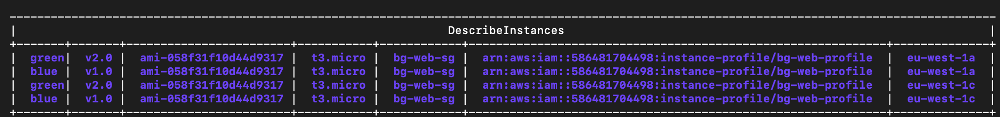 | Blue/Green parity |
| 02 | 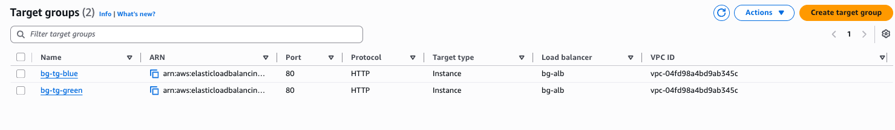 | Two target groups on bg-alb |
| 03 | 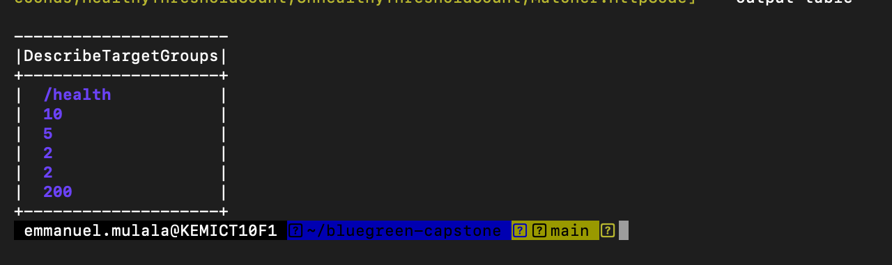 | Health check settings |
| 04 | 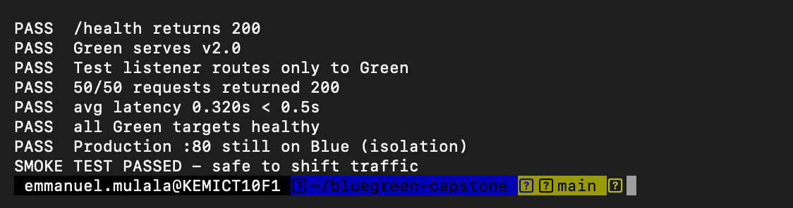 | Smoke tests 7/7 |
| 05 | 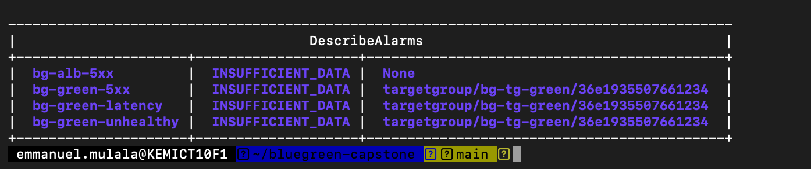 | Alarms created |
| 06 | 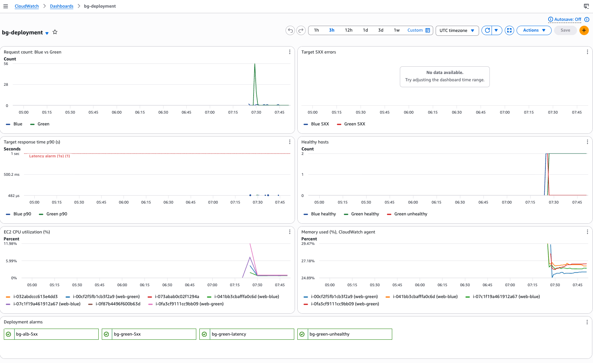 | Dashboard baseline |
| 07 | 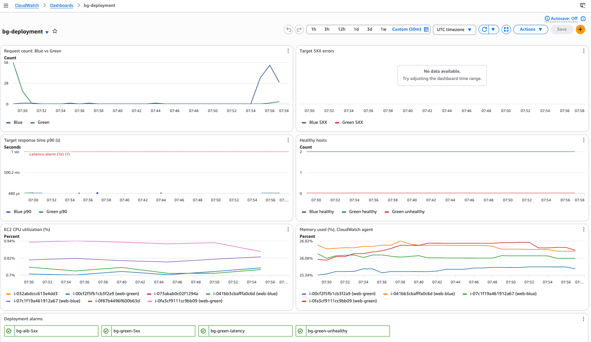 | 10% Green |
| 08 | 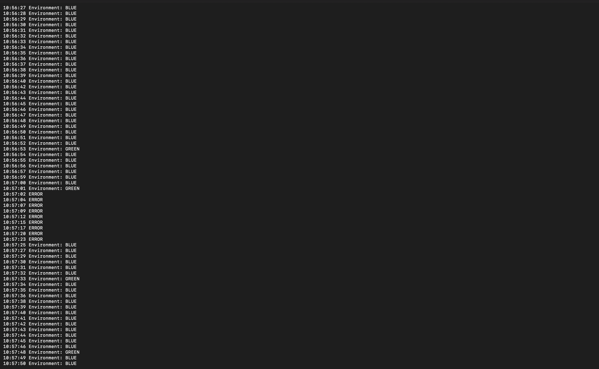 | Traffic log during switch |
| 09 | 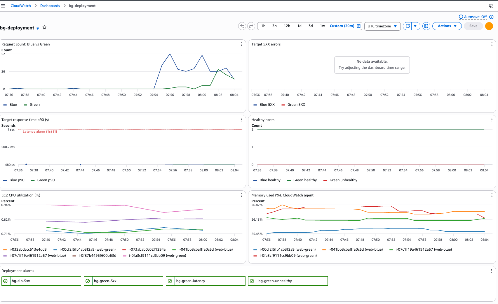 | 50/50 |
| 10 | 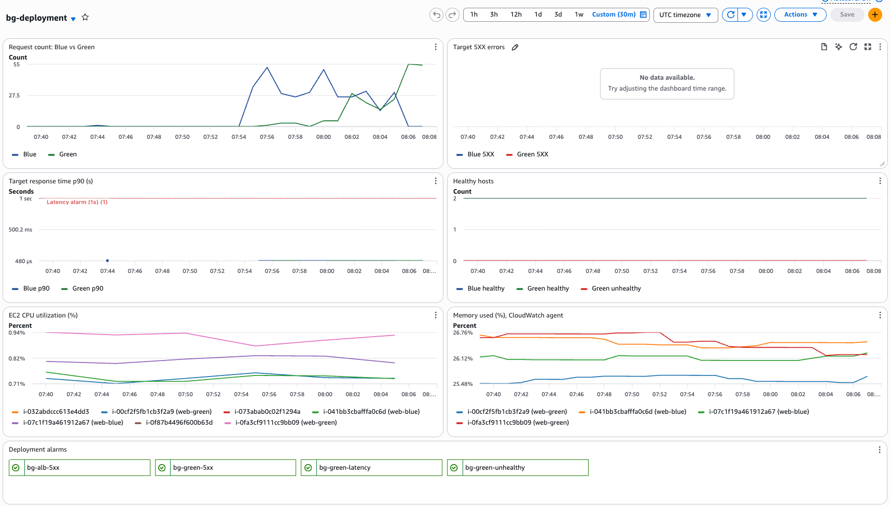 | 100% Green |
| 11 | 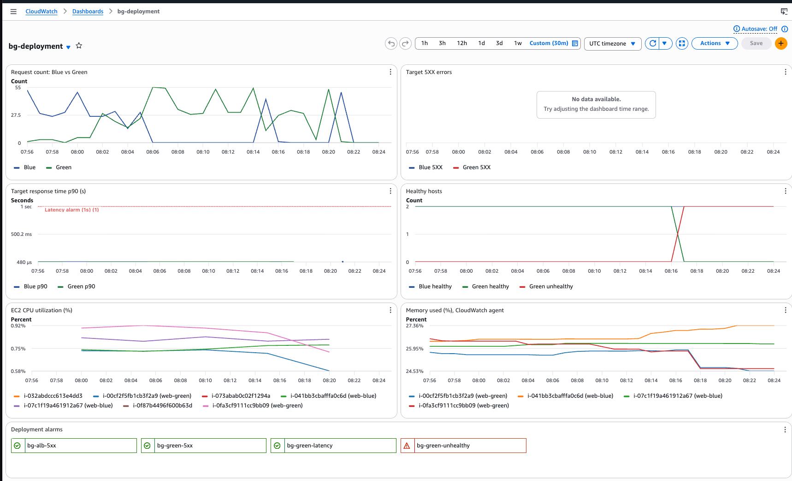 | Drill: Green unhealthy, alarm red |
| 12 | 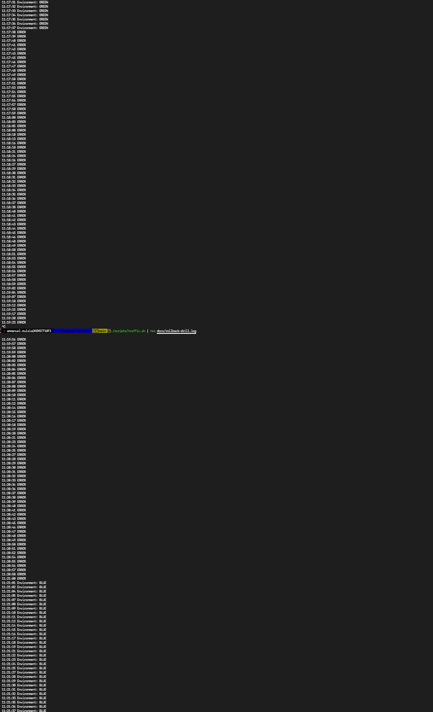 | GREEN → ERROR → BLUE |
| 13 | 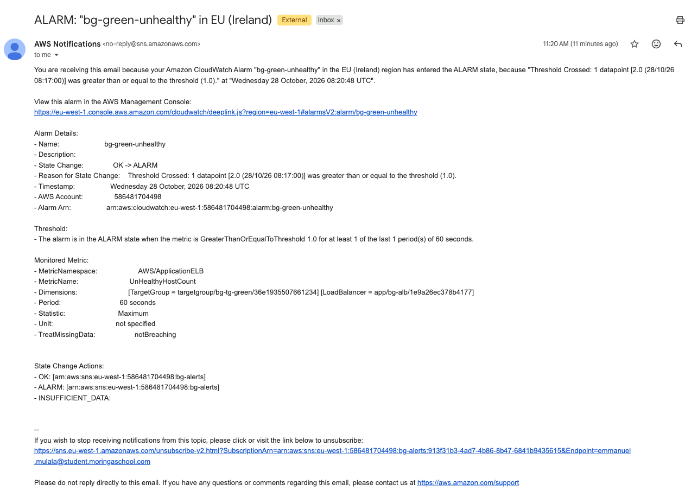 | Alarm email |
| 14 | 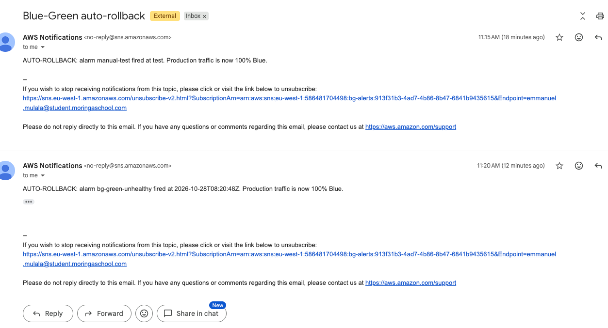 | Auto-rollback emails |
| 15 | 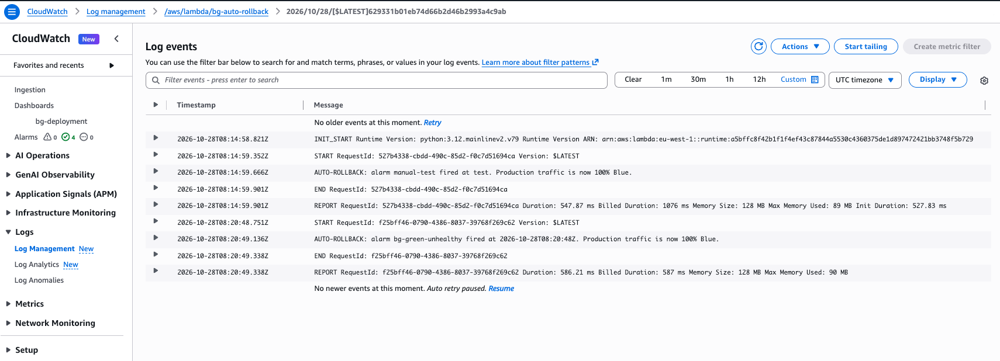 | Lambda rollback log |
